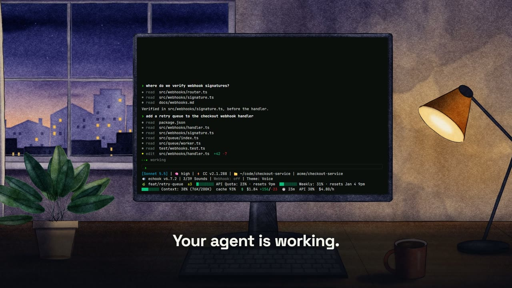
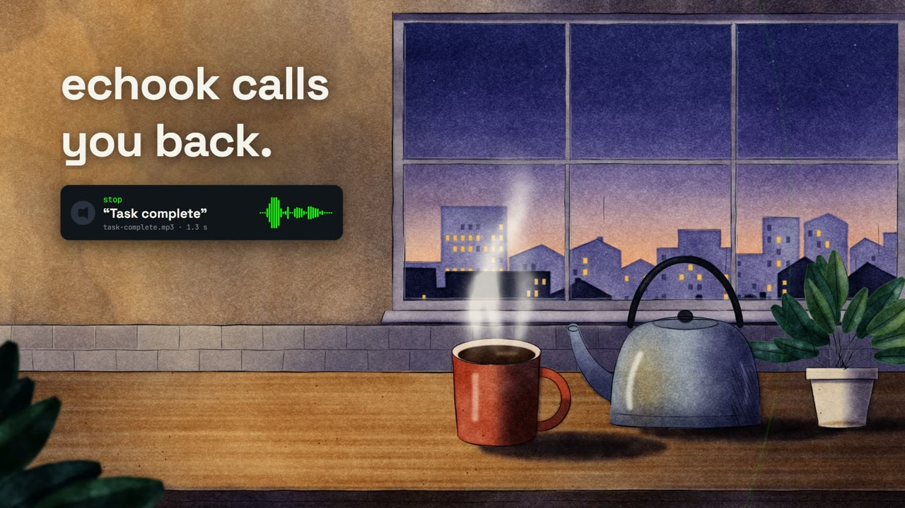
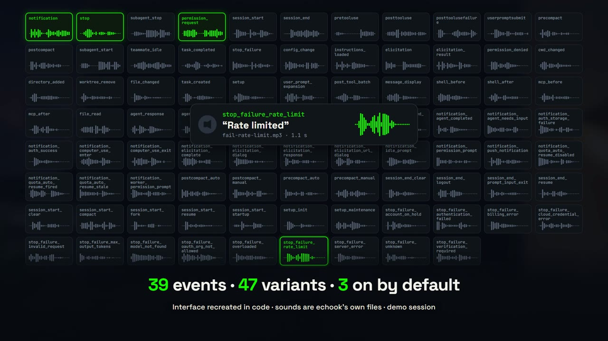
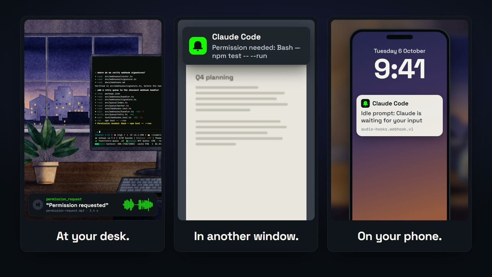
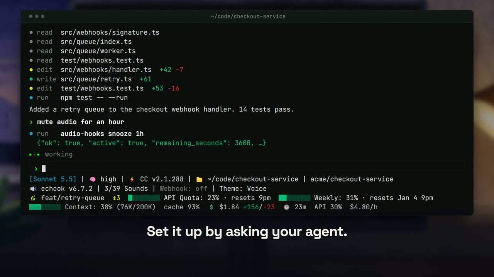
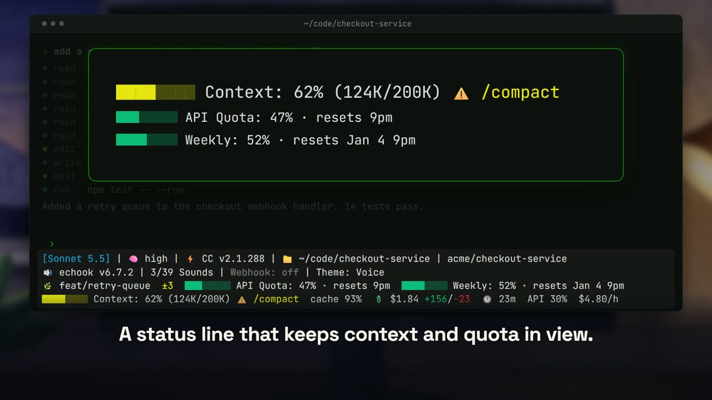
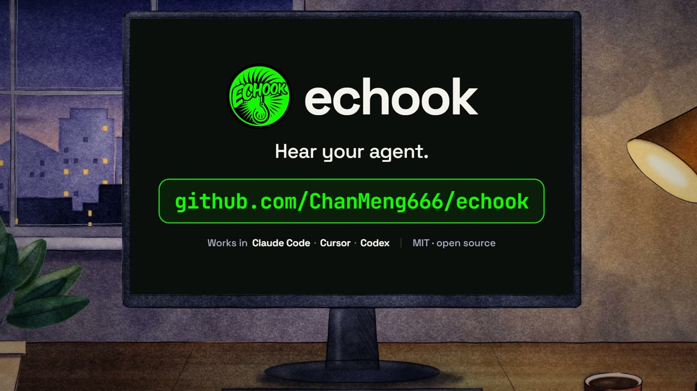
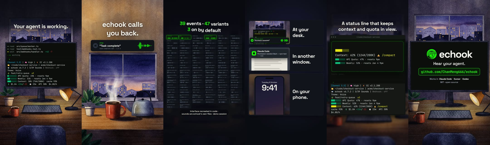

<div align="center">

# echook promo studio

**The promo film for [echook](https://github.com/ChanMeng666/echook), built entirely in code.**<br/>
A coded replica of the product's own interface, set in a procedurally painted room,<br/>
cut to a synthesised score, and held to automated gates.



</div>

[echook](https://github.com/ChanMeng666/echook) plays a different sound for each thing
your AI coding agent does — finishes a turn, asks permission, hits a rate limit — can
raise a desktop toast or call a webhook, and pins a status line with context and quota
bars to the bottom of the terminal. It works in Claude Code, Cursor and Codex.

This repository is the studio that makes its promo film: six masters (60 / 30 / 15 s,
each in 16:9 and 9:16) rendered with [Remotion](https://www.remotion.dev/) from one scene
library.

## What is unusual about it

| | |
|---|---|
| **No screen recording** | The terminal, status line, sound chips, desktop toast and phone notification are rebuilt as pure functions of time, so they can be re-laid-out for a vertical frame and re-timed to music. |
| **No invented product content** | Event names, counts, voice-line texts, the status line, CLI output and notification text are *baked* by running echook's real CLI and status-line script. Gates trace every text node on screen back to that data. |
| **The sound effects are the product** | Every event sound you hear is one of echook's own mp3 files, played at the moment the replica shows that event. The waveforms on screen are the peaks of those files. |
| **No SVG illustration, no AI images** | The room is painted by a watercolour-and-ink engine written in Python (numpy + OpenCV) and exported as depth layers for parallax. The only SVG is echook's own logo. |
| **A written score** | The music is synthesised from a score at 128 BPM, so 60 / 30 / 15 s are exactly 32 / 16 / 8 bars and every cut lands on a bar line. |

## The film

| | |
|---|---|
|  |  |
| **Away.** You leave the desk. The music drops to a pad and echook's real voice line is heard on its own. | **Every event has its own sound.** One tile per event and variant, each with the waveform of its real file. |
|  |  |
| **Channels.** A sound at your desk, a toast in another window, a webhook on your phone. | **Set it up by asking.** The command and its JSON result are the product's real output. |
|  |  |
| **Status line.** Real renders of echook's status-line script at three context levels. | **End.** Back at the desk where the film began. |

The vertical cuts are a re-layout, not a crop:



The 60 s cut has eight scenes: hook, away, events, themes, channels, talk, status line,
end. The shorter cuts drop scenes rather than playing them faster.

## Deliverables

30 fps, H.264 (yuv420p) + AAC 48 kHz. Loudness and true peak are measured on the delivered
files.

| composition | file | frames | loudness | true peak |
|---|---|---|---|---|
| `Echook-60-Landscape` | `echook_60s_landscape_1920x1080.mp4` | 1800 | -16.1 LUFS | -1.9 dBTP |
| `Echook-60-Vertical` | `echook_60s_vertical_1080x1920.mp4` | 1800 | -16.1 LUFS | -1.9 dBTP |
| `Echook-30-Landscape` | `echook_30s_landscape_1920x1080.mp4` | 900 | -16.0 LUFS | -2.0 dBTP |
| `Echook-30-Vertical` | `echook_30s_vertical_1080x1920.mp4` | 900 | -16.0 LUFS | -2.0 dBTP |
| `Echook-15-Landscape` | `echook_15s_landscape_1920x1080.mp4` | 450 | -16.1 LUFS | -2.1 dBTP |
| `Echook-15-Vertical` | `echook_15s_vertical_1080x1920.mp4` | 450 | -16.1 LUFS | -2.1 dBTP |

The mp4 files are written to `out/masters/` and are not committed.
[`out/masters/MANIFEST.json`](../out/masters/MANIFEST.json) is committed and records, for each
delivered file, its sha256, frame count, measured loudness and true peak, what was found
at every cut, whether each product sound is present at its cue, and the film and product
commits it was built from.

## Requirements

- Node.js 22 or newer
- `ffmpeg` and `ffprobe` on `PATH`
- Python 3 with numpy, scipy, opencv-python and pillow — only to repaint the art or
  re-synthesise the audio; their outputs are committed
- The echook repository checked out next to this one as `../claude-code-audio-hooks`
  (override with `ECHOOK_PRODUCT_DIR`) — only for `npm run bake` and the gates that
  re-check it. It is only ever read, and its CLI runs against a throwaway home.
- About 4 GB of free memory to render

## Commands

```bash
npm install
npm run bake          # echook repo -> src/replica/data/product.generated.json + public/audio/product/
npm run art           # paint the watercolour plates (Python)
npm run audio         # synthesise the score and the film-furniture effects (Python)
npm run verify        # the gate suite (re-runs the bake in --check mode)
node capture/mutate.mjs                              # break each invariant, expect red, restore
node capture/stills.mjs --comp Echook-60-Landscape   # frame 0, every 2 s, and the hand-over frames
node capture/tile-contact.mjs                        # contact sheets from the stills on disk
npm run render                                       # gates -> bundle once -> six masters, one at a time -> loudness -> manifest
node scripts/render.mjs --only 60l                   # one master (15|30|60 + l|v), or --only 30 for both aspects
node capture/check-masters.mjs                       # read the delivered files again
```

`bake`, `art` and `audio` are deterministic and their outputs are committed, so a fresh
clone renders without Python.

## How it is put together

```
docs/brief.md               the brief, the constraints registry (C1-C14), the story
docs/decisions.md           what was decided and why; the gates' mutation evidence; the look rounds
docs/copy-clearance.md      a row for every film-voice line and every demo-session string

scripts/bake-product-data.mjs       runs the product's real CLI and status-line script in a throwaway home
scripts/measure-product-sounds.mjs  loudness of the product sounds the film plays
scripts/render.mjs                  gates -> render -> fixed gain + peak limiter -> measure the delivered file
art/                        the watercolour engine and the painted plates (Python) -> public/art
audio/                      the score and the film-furniture effects (Python) -> public/audio

src/core/timeline.ts        the ONLY frame arithmetic; a boundary is a downbeat of the cut's own bed
src/core/layout-core.ts     the deliverables table, safe areas, where things sit in each aspect
src/core/camera.ts          views over a painted plate: translate + scale, parallax by depth
src/edits.ts                one edit decision list per length, in bars
src/scenes.ts               the scene library
src/copy.ts                 every film-voice word
src/cues.ts                 the cue sheet, derived by walking the cut
src/replica/demo.ts         the demo session: the only invented content
src/replica/screenplays.ts  when things happen in each scene, per cut
src/replica/*.tsx           Terminal + StatusLine, SoundChip, SoundWall, ThemeToggle, Ripple, Toast, Phone
src/components/             the painted plates, the eight scenes, the film's type
src/Film.tsx, Root.tsx      beats as sequences; audio in one place

capture/verify.mjs          the gates
capture/paint.mjs           paints the real scene components to markup in Node, for the gates
capture/mutate.mjs          mutation evidence
capture/stills.mjs, tile-contact.mjs, check-masters.mjs
```

Three rules hold the film honest:

- **Everything the product says or measures is baked from the product.** The `strings`
  and `numbers` gates paint every beat of all six compositions and trace each text node
  back to the baked data, the cleared copy, or the one demo file.
- **The replica is a pure function of time.** The scenes take a second and return a
  picture; there are no CSS transitions, no clocks and no unseeded randomness.
- **Intent in bars and seconds; one file converts to frames.**

The gates are `bake`, `assets`, `timeline`, `strings`, `numbers`, `copy`, `honesty`,
`audio` and `purity`. Each has mutation evidence: `capture/mutate.mjs` breaks one
invariant at a time, expects the gate to go red, and restores the file.

The film says on screen what it is — `Interface recreated in code · sounds are echook's
own files · demo session` — for the whole events scene of every cut. The session shown
(repository, costs, percentages) is a demo payload, not anyone's real data.

## Status

The six masters were rendered from commit `c680710` and reviewed and accepted by the
maintainer on 2026-10-06. The film-voice lines in `docs/copy-clearance.md` were approved
the same day. Known limits are recorded in `docs/decisions.md`: the terminal text inside
the painted monitor in the opening shot is small in 16:9, the tile names on the sound wall
are texture rather than readable text, and the film does not show echook's text-to-speech
channel because it could not be demonstrated without synthesising a voice the product did
not produce.

## Credits and licence

- The code in this repository is released under the [MIT License](../LICENSE).
- The product sounds in `public/audio/product/` and the logo in `public/echook-logo.svg`
  are echook's own files, copied unmodified from
  [ChanMeng666/echook](https://github.com/ChanMeng666/echook) (MIT).
- "Claude Code", "Cursor" and "Codex" are named as plain words because echook runs in
  them. This film is not affiliated with or endorsed by their makers.
- Rendered with [Remotion](https://www.remotion.dev/), which has its own
  [licence terms](https://www.remotion.dev/license) for companies.

Made by [Chan Meng](https://github.com/ChanMeng666) with Claude Code.
